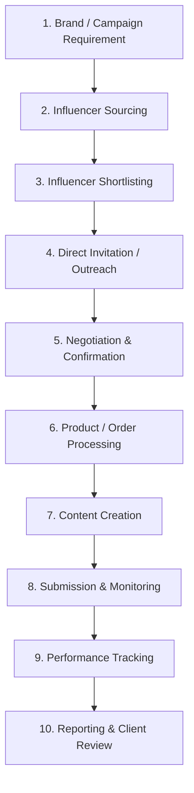

# Typical Closed Collaboration Process - Standard Operating Procedure (SOP)

This document outlines the **10-Step Typical Closed Collaboration Process** for Armful Media and how each phase maps directly to system modules in **Instroom**.

---

## Process Overview & System Mapping

---

### Step 1: Brand / Campaign Requirement
- **Description**: The client provides campaign details. Armful Media identifies target audience, platform (TikTok, Instagram, YouTube), content type, budget, and deliverables.
- **System Module**: `Manager -> Campaign Planning` (`/manager/campaign_planning` & `/manager/campaign_details`)
- **Key Actions**: Define campaign brief, set deliverables list, define target metrics, allocate budget.

---

### Step 2: Influencer Sourcing
- **Description**: The Influencer Relations team searches for influencers on target platforms (TikTok, Instagram, YouTube). Influencers are evaluated on niche, audience, engagement rate, location, content quality, and campaign fit.
- **System Module**: `Discovery & Influencer Database` (`/discovery` & `/influencer/manage`)
- **Key Actions**: Filter by platform, niche, follower thresholds, engagement rate, location.

---

### Step 3: Influencer Shortlisting
- **Description**: Suitable influencers are added to a campaign shortlist. Their profiles and performance metrics are organized for review.
- **System Module**: `Influencer Manager / Shortlist` (`/influencer/manage`)
- **Key Actions**: Select candidates, assign to campaign shortlist, compile organized profile cards for brand review.

---

### Step 4: Direct Invitation / Outreach
- **Description**: Instead of open marketplace postings, Armful Media directly contacts selected influencers with campaign details and asks for interest.
- **System Module**: `Pipeline -> Stage: For Outreach / Contacted` & `Inbox` (`/influencer/pipeline` & `/email`)
- **Key Actions**: Send direct invitation emails using standardized email drip templates, track email opens/replies in real time.

---

### Step 5: Negotiation & Confirmation
- **Description**: Agency and influencer discuss requirements, compensation, product samples, deadlines, and deliverables. Once both sides agree, creator is confirmed.
- **System Module**: `Pipeline -> Stage: Replied / In - Progress` (`/influencer/pipeline`)
- **Key Actions**: Set agreed fee, set deliverable requirements, define deadline dates, mark collaboration confirmed.

---

### Step 6: Product / Order Processing
- **Description**: If the campaign involves physical products, necessary order info, shipping address, discount code, or referral links are processed.
- **System Module**: `Closed Collaborations -> Stage: For Order Creation / In-Transit / Delivered` (`/influencer/closed_collaborations`)
- **Key Actions**: Track order fulfillment status, generate unique referral tracking links (`/tracking`), assign discount codes.

---

### Step 7: Content Creation
- **Description**: The influencer creates the required video/photo content according to the campaign brief.
- **System Module**: `My Tasks & Creator Portal` (`/influencer/my_tasks`)
- **Key Actions**: Influencers and relations team track content creation tasks, deadlines, and guidelines.

---

### Step 8: Submission & Monitoring
- **Description**: Armful Media monitors deliverable completion, live post URL submission, and campaign guideline compliance.
- **System Module**: `Closed Collaborations -> Stage: Posted & Submission Verification` (`/influencer/closed_collaborations`)
- **Key Actions**: Verify submitted post links, validate deliverable status (`Posted` / `Completed`), mark tasks done.

---

### Step 9: Performance Tracking
- **Description**: Collect performance metrics such as views, likes, comments, engagement rate, tracking link clicks, and sales GMV.
- **System Module**: `Performance Analytics` (`/influencer/analytics` & `/manager/performance`)
- **Key Actions**: Real-time stats dashboard, CPM calculation, platform performance doughnut breakdown, tracking link analytics.

---

### Step 10: Reporting
- **Description**: Campaign results are compiled into a executive presentation & performance report for the client.
- **System Module**: `Reports & PDF/CSV Export` (`/manager/reports`, `/manager/export_performance`, `/influencer/export_analytics_pdf`)
- **Key Actions**: Export UTF-8 BOM CSV reports, generate executive PDF reports, present ROI metrics to client.
